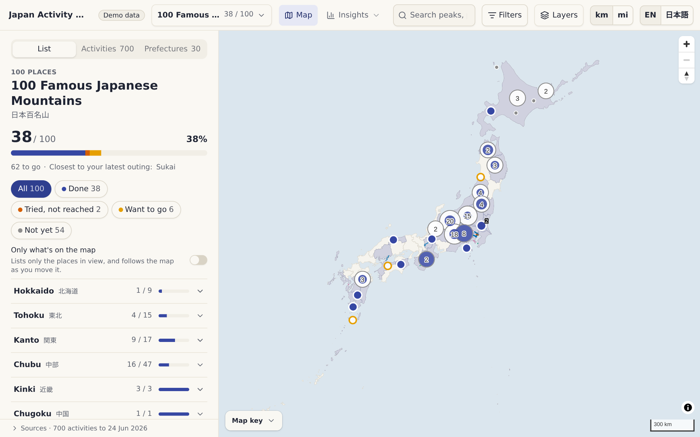
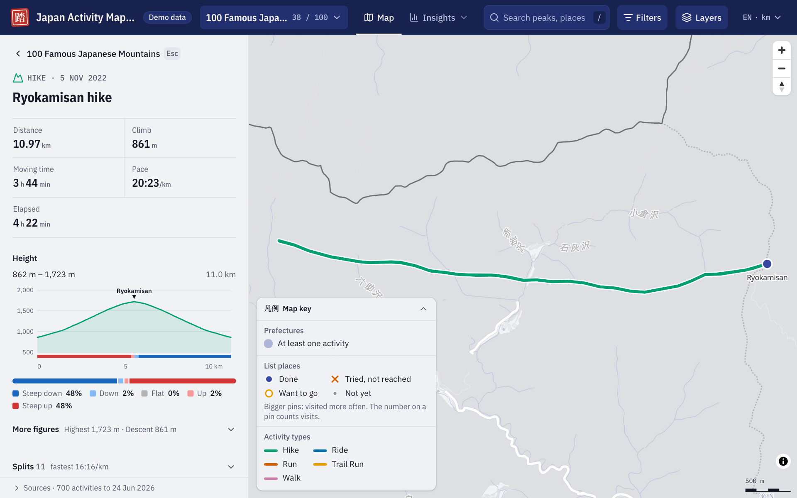
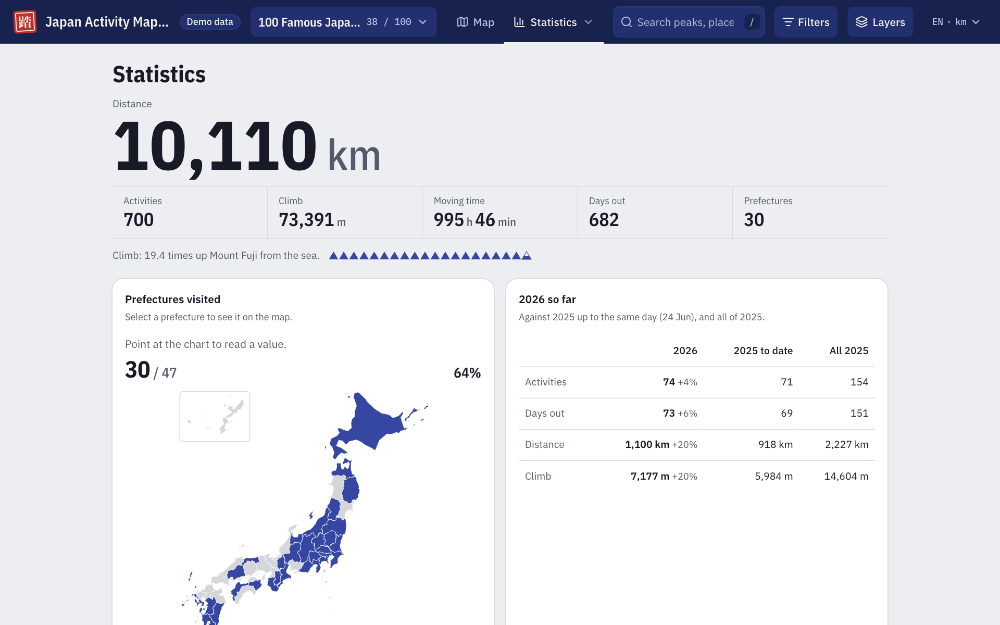
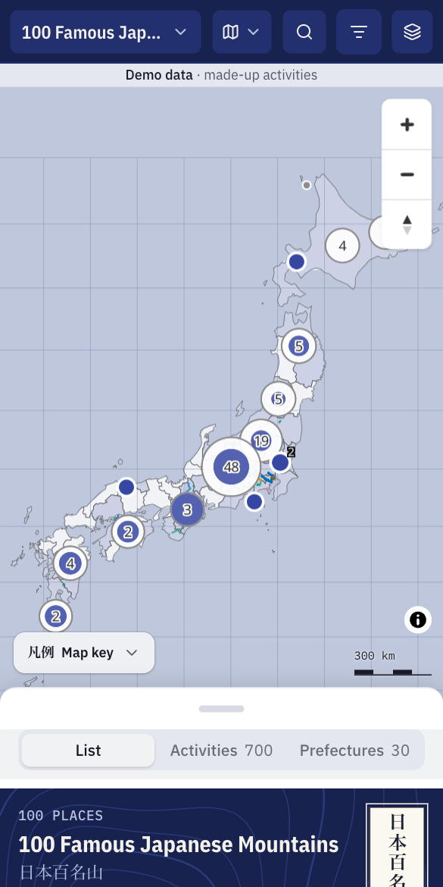
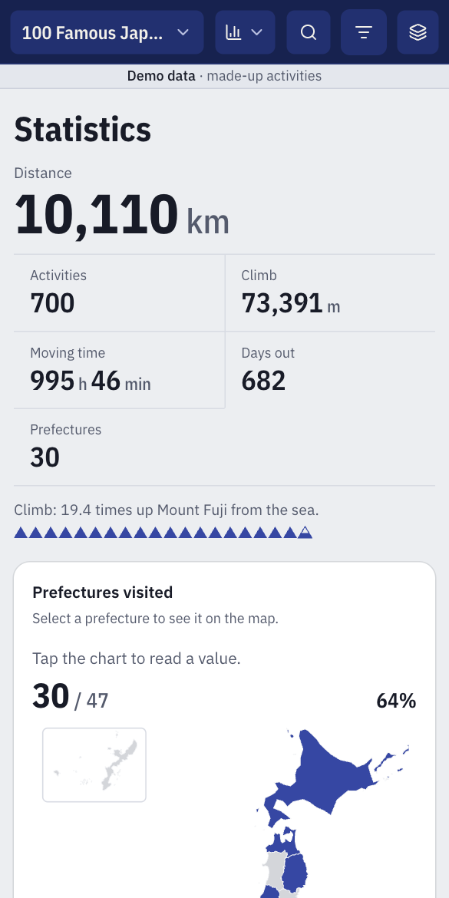
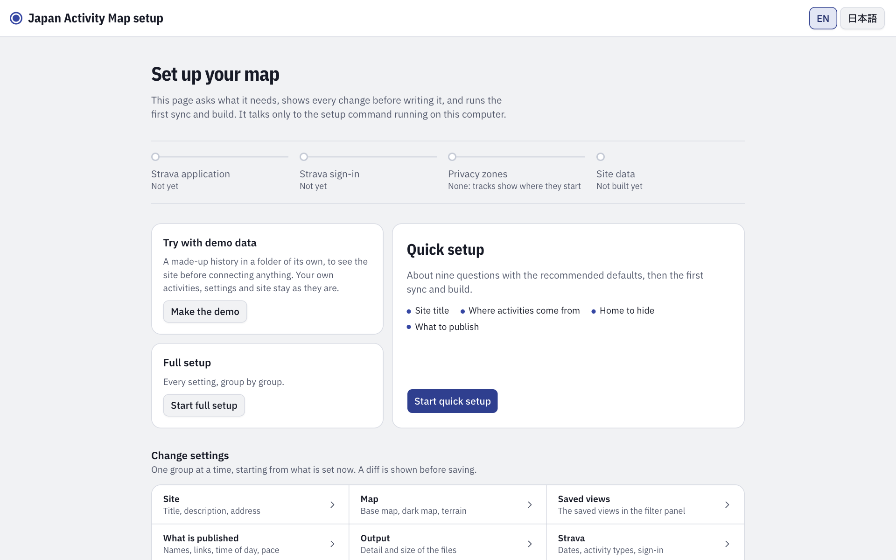

# Japan Activity Map

A personal map of Japan that ticks off famous peaks, trails and pilgrimage routes as you hike, run
and ride them.

It reads your activities from Strava, from Garmin Connect, from YAMAP, from GPX or FIT files, or from a
spreadsheet you keep by hand, does all the work on your own computer, and builds a static site you can host anywhere. Your home stays
off the map.

Live demo, with made-up activities: <https://mladimatija.github.io/japan-activity-map/>



Screenshots use demo data and a simplified map. The real site has a full base map.

## What you get

### Lists and progress

About 40 lists come built in. Each one shows how many you've done and what's left.

- Mountains: 日本百名山, 二百名山 and 三百名山, the highest point of every prefecture, the 3,000 m
  peaks, 花の百名山, 日本百低山, and regional hundreds for 山梨, 関東 and 関西.
- Castles, waterfalls and roads: the 100 castles and the second 100, 滝百選, 日本の道100選.
- Pilgrimages: 四国八十八箇所, 西国, 坂東 and 秩父.
- Long routes: the 五街道 (東海道, 中山道, 甲州, 日光, 奥州), 東海自然歩道, 熊野古道, 四国遍路,
  みちのく潮風トレイル, 九州オルレ, and National Cycle Routes such as しまなみ海道, ビワイチ and
  太平洋岸自転車道.

You don't tick anything by hand. If a track passes a summit, a temple or a castle, that place
counts as done. Long routes go by distance, so half of ビワイチ shows as half. The sheet can add a
place you turned back from or one you want to visit. Prefectures and municipalities are counted
too.

### The map

- A pin for every place on a list: done, tried, want to go, not yet. Pins grow the more often you
  visit.
- Your tracks, coloured by activity type or as a heatmap. Routes you repeat are drawn once, with a
  count.
- Prefectures shaded by activities, distance, climb or days.
- Explorer tiles: every map square you've been in, and the biggest solid square among them.
- Hillshade, 3D terrain and a dark map.
- Search for any place, route or activity. Filter by type, year, season, weekday, prefecture,
  distance, climb or time, and save a set of filters as a view with its own link.

### Activities

Open an activity to see its distance, climb, time and pace, a height profile with gradient, and
splits per kilometre or mile. You also get the places it reached, the prefectures it crossed, and
every other time you did the same route.



### Where activities come from

Strava, Garmin Connect (with your own personal API key), YAMAP (with the sign-in token from your
browser; unofficial, so read [docs/yamap.md](docs/yamap.md) first), or GPX and FIT files from any
app or watch that exports them, plus a sheet you keep by hand for everything else. One setting
says which of them the site is built from ([docs/garmin.md](docs/garmin.md),
[docs/gpx.md](docs/gpx.md)).

A sync fetches what's new since the last one. To fetch only some days, add `--from` and `--to`, or
`--last 30d`, to `sync strava`, `sync garmin` or `sync yamap`; the setup page has the same as two date fields.
Distances, climb and moving time of a recording read from a file are worked out from its points,
with GPS jumps left out ([docs/gpx.md](docs/gpx.md#moving-time-and-gps-jumps)).

### Other pages

- Statistics: totals by year, month, type and weekday, plus a calendar of every day.
- Repeats: the routes and places you keep going back to, with each visit on a timeline and your
  fastest time.
- Compare: two years side by side, including the ground that was new in each.
- Goals: records, a trip planner for finishing a list, and a picture of your year to share.

The site is in English and Japanese, in kilometres or miles.



### On a phone

The list becomes a sheet you pull up over the map, search opens full screen, and the chart pages
fit the narrow screen.

<p>
  
  
</p>

### Privacy

Nothing leaves your computer except the finished site. There's no server and no account.

- Privacy zones cut every track near your home or workplace. The cut is centred on a randomly
  shifted point, so the gap doesn't point at your door.
- You choose what gets published: names, times of day, pace, Strava links, private activities.
- An audit runs before every publish. It stops the build if a zone, an excluded activity, a token
  or an internal id turns up in the output ([docs/privacy.md](docs/privacy.md)).

### Setup and publishing

`pnpm jam setup` walks you through everything, in the terminal or on a page in your browser. It
asks a few questions, shows every change to your config files before saving it, then runs the
first sync and build.



When you're ready, one command publishes the site to Cloudflare Pages, Netlify or GitHub Pages,
and a weekly job can fetch, rebuild and publish by itself.

## Getting started

You need Node.js and pnpm (versions under [Requirements](#requirements)).

```sh
pnpm install
```

1. Try the demo. `pnpm jam demo`, then `pnpm demo:web`, gives you a complete site from made-up
   activities, stored separately from your own data ([docs/demo.md](docs/demo.md)).
2. Set up. `pnpm jam setup` asks a few questions: Strava, Garmin, YAMAP, GPX files or a sheet, where home is so it
   can be hidden, what to publish. Then it writes the config files and runs the first sync and build.
   `pnpm jam setup --web` does the same in your browser ([docs/setup.md](docs/setup.md)).
3. Check what gets cut. `pnpm jam zones --preview`, then `pnpm web:preview` to see the site as it
   will be published ([docs/privacy.md](docs/privacy.md)).
4. Publish. `pnpm jam deploy` sends the site to Cloudflare Pages, Netlify or GitHub Pages
   ([docs/deploy.md](docs/deploy.md)). It won't upload anything the privacy audit hasn't passed.
5. Keep it up to date. `pnpm jam update` syncs, rebuilds and publishes in one go;
   `pnpm jam schedule` makes that a weekly job.

Only `dist/` is ever published.

More in [docs/](docs): [the site](docs/web.md), [setup](docs/setup.md), [Strava](docs/strava-setup.md),
[Garmin](docs/garmin.md), [YAMAP](docs/yamap.md), [GPX files](docs/gpx.md), [privacy](docs/privacy.md), [matching](docs/matching.md), [routes](docs/routes.md),
[the build](docs/build.md), [demo data](docs/demo.md), [publishing](docs/deploy.md), and
[the lists and their sources](lists/README.md).

---

Everything below is for working on the code.

## Requirements

- Node.js 26.13.1 (pinned in `.node-version`, `.nvmrc` and `package.json`)
- pnpm 12.21.0 (pinned in `package.json`)
- Optional: the [Vite+](https://viteplus.dev) global CLI (`vp`), which picks the pinned Node.js and
  pnpm versions for you

## Commands

| Command                   | What                                                                                 |
| ------------------------- | ------------------------------------------------------------------------------------ |
| `pnpm jam status`         | Config, local store, activity counts and the last pulls                              |
| `pnpm jam lists fetch`    | Download the network sources for the reference lists (run on your own machine)       |
| `pnpm jam lists build`    | Build the reference lists from `lists/sources`                                       |
| `pnpm jam lists validate` | Check the built lists                                                                |
| `pnpm jam sync sheet`     | Import the manual activity sheet (`templates/README.md`)                             |
| `pnpm jam strava auth`    | Sign in to Strava ([setup](docs/strava-setup.md))                                    |
| `pnpm jam sync strava`    | Fetch Strava activities since the last pull; `--tracks-from` reads exported files    |
| `pnpm jam strava wipe`    | Delete Strava activities from the store, keeping sheet data (`--yes`)                |
| `pnpm jam sync garmin`    | Fetch Garmin Connect activities with your own key; `--from`/`--to` work here too     |
| `pnpm jam garmin check`   | Check that the Garmin key works                                                      |
| `pnpm jam garmin wipe`    | Delete Garmin activities from the store, keeping everything else (`--yes`)           |
| `pnpm jam sync yamap`     | Fetch your YAMAP activities with your sign-in token ([setup](docs/yamap.md))         |
| `pnpm jam yamap token`    | Store a new YAMAP token when the old one expires: paste it, or pipe it in            |
| `pnpm jam yamap check`    | Check that the YAMAP user id and token work                                          |
| `pnpm jam yamap wipe`     | Delete YAMAP activities from the store, keeping everything else (`--yes`)            |
| `pnpm jam sync gpx`       | Import GPX or FIT files from a folder or a `.zip` ([how](docs/gpx.md)); `--replace`  |
| `pnpm jam gpx wipe`       | Delete GPX activities from the store, keeping everything else (`--yes`)              |
| `pnpm jam match`          | Match activities to list places, routes and prefectures ([how](docs/matching.md))    |
| `pnpm jam match ignore`   | Mark an automatic match as false                                                     |
| `pnpm jam routes`         | Group repeated activities into routes ([how](docs/routes.md))                        |
| `pnpm jam routes review`  | List routes that may need merging or splitting                                       |
| `pnpm jam routes regroup` | Regroup from scratch, keeping names and ids                                          |
| `pnpm jam zones`          | What the privacy zones and publish rules do ([how](docs/privacy.md))                 |
| `pnpm jam audit`          | Check an output folder for anything private                                          |
| `pnpm jam build`          | Build the site's data files into `dist/data` ([how](docs/build.md))                  |
| `pnpm jam deploy`         | Audit `dist`, publish to Cloudflare, Netlify or GitHub Pages ([how](docs/deploy.md)) |
| `pnpm jam update`         | The weekly run: sync, group, build and deploy, stopping at the first failure         |
| `pnpm jam schedule`       | Write a weekly job that runs `jam update`, for you to install                        |
| `pnpm jam backup`         | Copy the local store to `data/backups`                                               |
| `pnpm jam demo`           | Made-up demo data in `data/demo`, apart from your own ([how](docs/demo.md))          |
| `pnpm demo:web`           | Run the map locally over the demo data                                               |
| `pnpm jam setup`          | Set up or change settings step by step; `--web` for a page ([how](docs/setup.md))    |
| `pnpm web:dev`            | Run the map locally over `dist/data` ([how](docs/web.md))                            |
| `pnpm web:build`          | Build the map into `dist`, beside `dist/data`                                        |
| `pnpm web:preview`        | Serve the built site (`dist`) as it will be published                                |

Every command takes `--dry-run`, `--verbose` and `--help`. The local store (`data/jam.sqlite`)
is created on first use and migrated automatically; it is copied to `data/backups` before any
migration or wipe.

## Layout

| Path            | What                                                     | Committed     |
| --------------- | -------------------------------------------------------- | ------------- |
| `packages/core` | Shared types and config schemas                          | Yes           |
| `packages/cli`  | The `jam` command: sync, build, audit, deploy            | Yes           |
| `packages/web`  | The public site: React and MapLibre                      | Yes           |
| `lists/`        | Reference lists                                          | Yes           |
| `templates/`    | The activity sheet template and its column spec          | Yes           |
| `docs/`         | Guides, one per part                                     | Yes           |
| `config/`       | Settings; only the `*.example.jsonc` files are committed | Examples only |
| `data/`         | Local store, logs and backups                            | No            |
| `dist/`         | Build output: your site, as `jam deploy` publishes it    | No            |
| `dist-demo/`    | The demo site (`pnpm demo:site`)                         | No            |

## Tooling

[Vite+](https://viteplus.dev) does formatting (Oxfmt), linting (Oxlint) and type checking
(TypeScript 7) in one pass. Its config is the root `vite.config.ts`. TypeScript runs directly on
Node.js 26, so the command-line tool has no build step.

| Command               | What it does                                                                                |
| --------------------- | ------------------------------------------------------------------------------------------- |
| `pnpm check`          | Format, lint and type check                                                                 |
| `pnpm fix`            | Apply the automatic fixes                                                                   |
| `pnpm test`           | Unit tests                                                                                  |
| `pnpm check:strava`   | The Strava sync, against a fake server                                                      |
| `pnpm check:match`    | Matching, on made-up activities (`packages/cli/dev`)                                        |
| `pnpm check:routes`   | Route grouping, likewise                                                                    |
| `pnpm check:gpx`      | GPX import and the Strava or GPX switch, likewise                                           |
| `pnpm check:garmin`   | The Garmin sync, against a stand-in server                                                  |
| `pnpm check:yamap`    | The YAMAP sync, against a stand-in server                                                   |
| `pnpm check:privacy`  | The privacy rules, likewise                                                                 |
| `pnpm check:build`    | The build, likewise                                                                         |
| `pnpm check:web`      | Renders the map's pane for every list and selection, against your real build in `dist/data` |
| `pnpm check:web:demo` | The same, against a demo build made in a temporary folder                                   |
| `pnpm check:bundle`   | The size budget of the web app's code, after `pnpm web:build`                               |
| `pnpm check:demo`     | `jam demo` itself                                                                           |
| `pnpm check:deploy`   | Deploying to each host, against stand-ins; uploads nothing                                  |

## Licence

The code and documentation are under the MIT licence ([LICENSE](LICENSE)). The reference data in
`lists/` is not: each source keeps its own terms (GSI, MLIT, OpenStreetMap's ODbL, Wikipedia's
CC BY-SA, and others), listed in [lists/LICENSE.md](lists/LICENSE.md). Your own activities in
`data/` are yours and are never part of the repository.

This project is not affiliated with Strava, Garmin or YAMAP. It uses the Strava API under your own
API application and Strava's terms, and the Garmin Connect Personal API under your own key and
Garmin's terms. YAMAP has no public API: `sync yamap` uses the web API of yamap.com with your own
sign-in, for your own activities only, and whether that suits YAMAP's terms is for you to judge
(docs/yamap.md). FIT files are read with Garmin's FIT SDK (`@garmin/fitsdk`), a dependency under
Garmin's FIT Protocol License, which is not an open-source licence.
