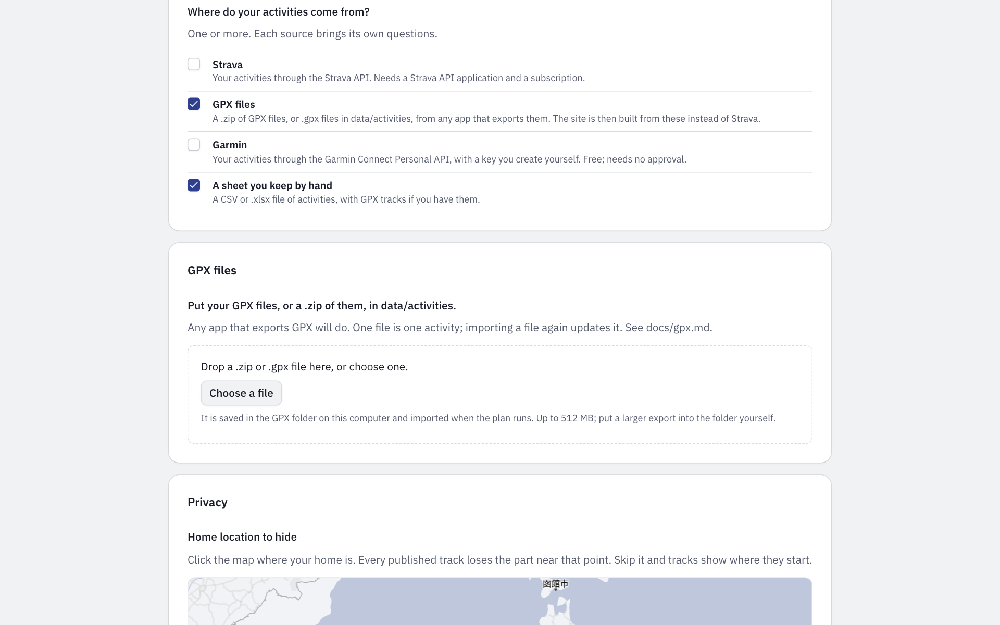

# GPX files

`pnpm jam sync gpx` imports activities from GPX files, and from FIT files (what Garmin, Wahoo,
Coros and Suunto devices record), for when you don't use Strava or don't want to. Any app that exports GPX will do: YAMAP's download button on an activity, Garmin Connect,
Komoot or a watch's own export. Each file becomes one activity in the local
store, with its track, heights and times, so height profiles and splits work as they do for Strava
activities with full tracks.

```sh
pnpm jam sync gpx                    # the folder data/activities
pnpm jam sync gpx ~/Downloads/export.zip
pnpm jam sync gpx ~/tracks           # any folder
pnpm jam sync gpx --dry-run          # say what would change, write nothing
pnpm jam sync gpx --replace          # also remove GPX activities that aren't in this import
pnpm jam gpx wipe                    # say what would be deleted; --yes deletes
```

## What is read

Give a folder or a `.zip` archive. Without a path it reads `data/activities`, which is git-ignored
like the rest of `data/`. Set another folder as `activities.gpx.folder` in `config/site.jsonc`.

- In a folder: every `.gpx` and `.fit` file, in subfolders too, and every `.zip` archive, which is read as
  below. Hidden files, links and other kinds of file are left alone.
- In an archive: every `.gpx` and `.fit` file. Folders, `__MACOSX`, hidden files and everything else are left
  alone, including archives inside the archive.

One file is one activity, however many tracks and segments it has. A file with only a route
(`<rte>`) is read as a track. Waypoints are ignored.

A FIT file is read with Garmin's FIT SDK: its recorded positions, heights and times, with a new
segment where the watch was paused. Its type comes from the sport the device recorded (running,
trail running, hiking, walking, cycling); points without a position, as at the start of an indoor
session, are left out. FIT files have no name of their own, so the file name is the activity's.
Fetching straight from Garmin Connect is a separate source (docs/garmin.md).

| Field          | Comes from                                                                               |
| -------------- | ---------------------------------------------------------------------------------------- |
| Name           | the file's own name (its metadata, else its first track), else the file name             |
| Type           | the track's `<type>`, else `activities.gpx.defaultType` (Hike)                           |
| Date and start | the first point's time; without times, the metadata's time, else a date in the file name |
| Distance       | the length of the track                                                                  |
| Climb          | the heights, counting a rise once it passes 5 m; none without heights                    |
| Elapsed time   | first point to last                                                                      |
| Moving time    | the time spent getting somewhere: see "Moving time and GPS jumps" below                  |

The type is read loosely: "Hiking", "hike", "trail_running", "Trail Run", "cycling", "Walk",
"登山", "ハイキング", "ランニング", "トレイルランニング", "サイクリング" and "ウォーキング" are
all understood. Anything else, such as "Kayaking", gets the default type.

Local times use the time zone in `config/sheet.jsonc` (Asia/Tokyo unless you changed it).

The summary lists every file added (`+`), updated (`~`), removed (`-`) and skipped (`!`, with the
reason). A file that can't be read, has no track or has no date is skipped; the rest are imported.
Each import is recorded, and `pnpm jam status` shows the last one.

## Importing again

A GPX activity is recognised by the time of its first point, to the second. Importing the same
file again, from the folder or from an archive, under another file name or with a new name inside,
updates that activity and never adds a second one. Two files in one import that start at the same
second are one activity: the first is kept and the second is skipped, with a line saying so.

A file without times is recognised by its points instead, so it stays one activity as long as its
track doesn't change.

Because of this an activity keeps its public id, and its place in a grouped route, through any
number of imports, and through `gpx wipe` followed by a fresh import.

Without `--replace` nothing is ever removed: an import only adds and updates. With `--replace`,
GPX activities that aren't in this import are removed, after the store is copied to
`data/backups`. If no file can be read as an activity, `--replace` removes nothing and says so. An activity whose
own file is there but can't be read this time (damaged, cut short) is kept too, with a line
saying so: fix or delete the file and import again.

`pnpm jam gpx wipe --yes` deletes every GPX activity and its track, after a copy of the store. The
files themselves aren't touched. No GPX command reads or changes a Strava activity or a sheet row.

## From the setup page

`pnpm jam setup --web` offers "GPX files" under "Where activities come from". Drop a `.zip` or
a `.gpx` there and it is saved into `data/activities` on your computer, then imported when the
plan runs (docs/setup.md).



## Building the site from GPX files

The store can hold Strava activities and GPX activities side by side. `config/site.jsonc` says
which of the two the site is built from:

```jsonc
{
  "activities": {
    "source": "gpx", // or "strava", the default
  },
}
```

`pnpm jam build` then publishes the GPX activities and the sheet's own rows, and leaves the Strava
ones out, listing them under "Left out". Everything public follows: tracks, list statuses, routes,
prefectures and statistics. Switch back to `"strava"` and build again to get the other site.
Switching deletes nothing.

- The sheet is always on. Its own rows are published with either source.
- A sheet row that corrects a Strava activity (through `strava_id`) has no effect while the site
  is built from GPX files, since that activity isn't published.
- `pnpm jam match` and `pnpm jam routes` still work on everything in the store. They are your own
  view, and keeping both matched makes switching quick.
- A grouped route is published with the activities of the chosen source and the sheet only
  (docs/routes.md).
- `pnpm jam update` imports the GPX folder instead of asking Strava.
- On the site, the Source filter offers "GPX" beside "Manual sheet". A GPX activity never has a
  link to another site.

## Privacy

Privacy zones, the publish rules and the audit apply to GPX activities exactly as to the others
(docs/privacy.md). File names and folders stay in the local store and are never published; the
name inside the file is published as the activity's name unless `publish.activityNames` is off.

## Moving time and GPS jumps

These apply to every recording read from a file: GPX, FIT, and what `jam sync garmin` downloads.

Moving time is judged over stretches of at least 30 seconds, by how far each stretch got in a
straight line. Slower than about 0.5 km/h counts as standing still, so a watch wobbling on the spot
adds nothing, and a steep climb at a few hundred metres an hour still counts. Some apps (YAMAP is
one) write a point every 20 m instead of every second, which says nothing about a rest between two
points. So a stretch never counts for longer than walking its length slowly would take (0.9 km/h,
plus its climb at 360 m an hour).

A point is dropped as a GPS jump when reaching it from the last good point would take more than
the activity's top speed: 18 km/h for a hike or a walk, 36 km/h for a run, 108 km/h for a ride. The
dropped points are left out of the distance, the climb and the track on the map. If more than one
point in twenty would go, the file is probably not the type it was given (a ride read as a hike),
and it is kept exactly as recorded; set its `<type>` or `defaultType` and import again. Files
without times keep every point.

A recording that spans two days is still one activity, dated by its first point. Its elapsed time
runs from the first point to the last, the night included; its moving time doesn't.

## Limits

- No setting per file. There is no way to hide one GPX activity or to give it event tags; take the
  file out of the folder and import with `--replace`, or keep the activity in the sheet instead.
- The sheet can't correct a GPX activity the way `strava_id` corrects a Strava one. Rename the
  track inside the file, or its `<type>`, and import again.
- An activity recorded in both Strava and a GPX file is two activities in the store. Only one of
  them is published, because the site is built from one source.
- Zip archives: stored and deflated files only. Zip64 archives (over 4 GB or 65,535 files),
  archives with a password and archives split into parts aren't read; unpack them and import the
  folder. A GPX file may unpack to at most 64 MB, an archive's GPX files to 2 GB in all, and an
  archive may be at most 1 GB itself.
- Files without times have no elapsed time, no moving time and no splits.
- Heart rate, cadence and other extensions aren't read, from GPX or FIT.
- The setup page's drop area takes `.zip` and `.gpx`; put `.fit` files in a `.zip` or straight
  into the folder.

## Trying it

`pnpm check:gpx` runs the checks on made-up tracks around 東京駅 in a temporary folder.
