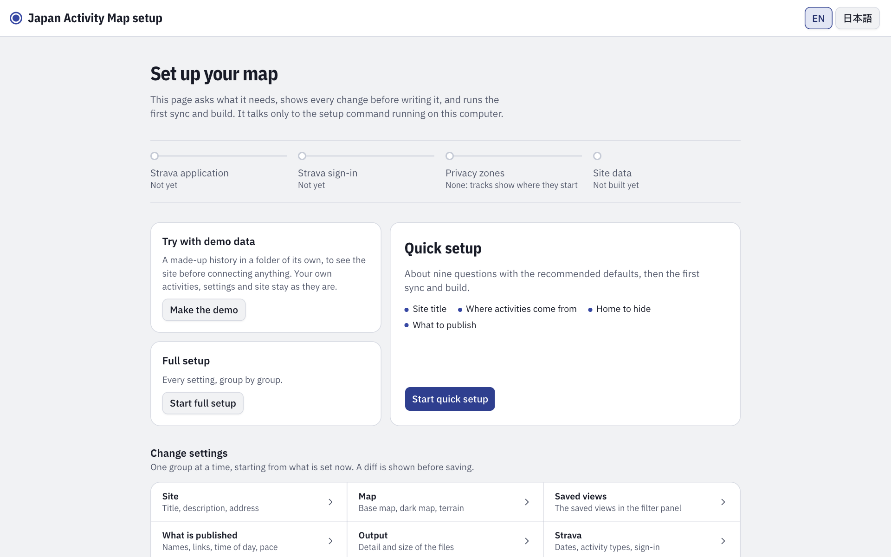
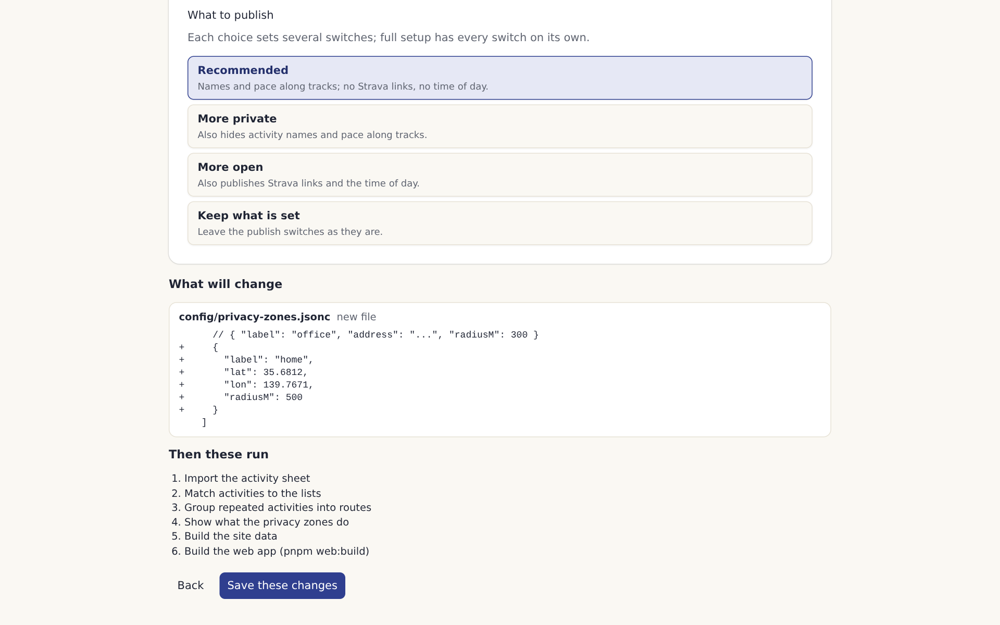
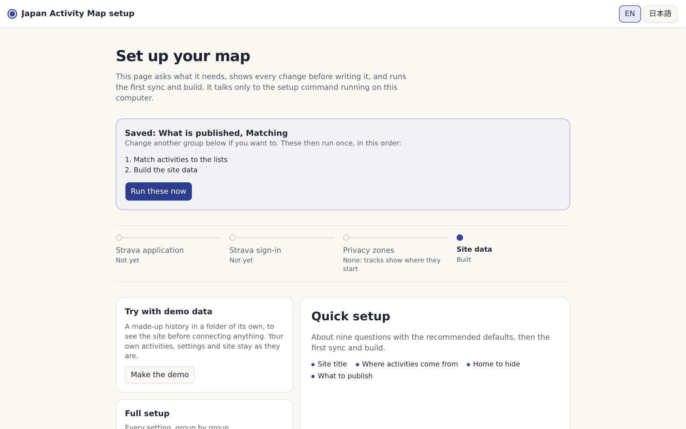

# Setup

`jam setup` asks what it needs, writes the config files and runs the first sync and build. It has
two front ends over the same steps: questions in the terminal, and a page in the browser.

```sh
pnpm jam setup                  # asks: demo data, quick setup, full setup or change settings
pnpm jam setup --quick          # about nine questions, recommended defaults
pnpm jam setup --full           # every setting, group by group
pnpm jam setup --change         # one group of settings; `--change privacy` goes straight there
pnpm jam setup --dry-run        # show the changes and the plan; write and run nothing
pnpm setup:build                # once, builds the setup page
pnpm jam setup --web            # the same steps on a page in your browser
```



Nothing here is needed to use the project: every file the wizard writes can be written by hand
(`config/README.md`), and every command it runs can be typed.

## What it does

1. Asks. Each answer is checked against the same schema the commands use, so a wrong value is
   refused on the spot and never reaches a file.
2. Shows the changes. A diff of each config file, with secrets masked, and the plan: the
   commands it will run, marked when one needs the network, opens a browser or is slow.
3. Writes. Only after you agree. One value is replaced where it stands, so comments and
   everything you didn't change stay byte for byte. A file that doesn't exist yet starts as a
   copy of its example, comments included. Files are written to a temporary name and renamed;
   `secrets.jsonc` and `privacy-zones.jsonc` are readable by you only.
4. Runs the plan, one command after another, with each command's usual output.
5. Tells you what to do next: the review files worth reading, how to see the site, the weekly
   commands.

Before anything is saved, the page shows the same thing the terminal prints: the diff and the plan.



In the terminal, a quick setup with a sheet and a home location looks like this:

```text
Config changes:

  config/site.jsonc (new, from the example)
        "site": {
    -     "title": "Japan Activity Map",
    +     "title": "My Japan map",

  config/privacy-zones.jsonc (new, from the example)
    +     {
    +       "label": "home",
    +       "lat": 35.6812,
    +       "lon": 139.7671,
    +       "radiusM": 500
    +     }

Plan:
  1. Import the activity sheet
      pnpm jam sync sheet
  2. Match activities to the lists
      pnpm jam match
  3. Group repeated activities into routes
      pnpm jam routes
  4. Show what the privacy zones do
      pnpm jam zones
  5. Build the site data
      pnpm jam build
  6. Build the web app (pnpm web:build) [slow: about a minute]
      pnpm web:build
```

If a command fails (Strava's rate limit, no network), fix what it says and run `pnpm jam setup`
again: the answers are already in the config files, and the run continues from the step that
failed. Stopping with Ctrl-C while answering keeps the answers given so far.

## The first screen

| Choice             | What happens                                                                      |
| ------------------ | --------------------------------------------------------------------------------- |
| Try with demo data | Runs `pnpm jam demo`: a made-up history in its own folder. Your data is untouched |
| Quick setup        | The questions below                                                               |
| Full setup         | Every setting in every config file, in groups                                     |
| Change settings    | One group, starting from the current values                                       |

Demo data is offered only when this version has the `demo` command; otherwise the choice says
"not available in this version".

## Quick setup

| Question                              | Default            | Writes                                                                       |
| ------------------------------------- | ------------------ | ---------------------------------------------------------------------------- |
| Site title                            | Japan Activity Map | `site.title` in `site.jsonc`                                                 |
| Where activities come from            | Strava             | decides the questions and commands that follow; see below                    |
| Is your Strava application ready?     | yes                | nothing; explains the callback domain, the 10-athlete upgrade, subscription  |
| Strava Client ID                      | none               | `strava.clientId` in `secrets.jsonc`                                         |
| Strava Client Secret (typed hidden)   | none               | `strava.clientSecret` in `secrets.jsonc`                                     |
| Import "Only You" activities?         | no                 | `import.includePrivate` in `strava.jsonc`, `publish.includeOnlyMeActivities` |
| Home location to hide (lat, lon)      | none; may be empty | the first zone in `privacy-zones.jsonc`                                      |
| Hide radius                           | 500 m              | that zone's `radiusM`                                                        |
| What to publish                       | Recommended        | several `publish.*` switches                                                 |
| Write these changes? / Run these now? | yes                |                                                                              |

"Where activities come from" offers Strava, GPX files and a sheet you keep by hand; choose one or
more. Choosing GPX files without Strava sets `activities.source` in `site.jsonc` to `gpx`, so the
site is built from them (docs/gpx.md), and leaves out every Strava question and command. Choosing
Strava without GPX files sets it to `strava`. With both chosen, one more question asks which of
the two the site is built from. Put the files, or a `.zip` of them, in `data/activities` before
the plan runs; the page can take a `.zip` for you (below).

Everything else keeps the default in the example files. The reasons for the ones that matter:

| Setting                    | Quick default | Why                                                                         |
| -------------------------- | ------------- | --------------------------------------------------------------------------- |
| Strava links               | off           | A link leads back to your profile                                           |
| Activity names             | on            |                                                                             |
| Time of day                | off           | Start times repeated over months show a routine                             |
| Pace along tracks          | on            | Holds no time of day and nothing from inside a zone                         |
| Activities without GPS     | off           |                                                                             |
| Commutes in the heatmap    | off           | They trace the line between home and work                                   |
| Terrain                    | off           | Set it in full setup or `--change map`                                      |
| Activity types, date range | all, all      |                                                                             |
| Full tracks per sync       | 80            | One 15-minute Strava window                                                 |
| Reference sources fetched  | only missing  | `gokaido` and `wikipedia` on a fresh clone; no `outlines`, no `osm` refresh |

"What to publish" has three presets. Recommended is the table above. More private also turns
activity names and pace along tracks off. More open turns Strava links and the time of day on.

The plan of a quick setup: download and build the missing reference lists, `strava auth` and
`sync strava` if Strava was chosen, `sync gpx` if GPX files were, `sync sheet` if a sheet was,
`match`, `routes`, `zones`, `build`, `pnpm web:build`. It then prints `pnpm web:preview` rather than starting a server.

## Full setup and change mode

Groups, in order: `site`, `map` (light and dark style, terrain), `views`, `publish` (seven
switches), `output`, the sources (`strava`: dates, types, sport types, full tracks, API addresses;
`gpx`: which of Strava and GPX files the site is built from, the type of a file that names none,
the folder; `sheet`), `privacy` (the zones, and the three privacy thresholds), `lists` (what to download now),
`matching`, `routeGrouping`, `routes` (names, merges and splits, as JSON), `deploy`.

- A value in brackets is the current one; Enter keeps it. `-` empties an optional value.
- Zones are added and removed by label. A position is typed as latitude and longitude; addresses
  aren't looked up, and a position outside Japan is refused.
- Lists and objects (saved views, sport types, per-list radius, route names) are typed as JSON.
- The deploy group asks where the site is published (Cloudflare Pages, Netlify or GitHub Pages),
  then what that host needs: the project name and its token (Cloudflare also its account id), or
  the GitHub repository, which needs no token; then `site.baseUrl`. A token is typed hidden,
  stored in `config/secrets.jsonc` and never shown again; it can be left empty and added later.
  Unattended, they come from `JAM_CLOUDFLARE_API_TOKEN`, `JAM_CLOUDFLARE_ACCOUNT_ID` and
  `JAM_NETLIFY_TOKEN`, in the environment or through `--secrets-stdin`.

On the page, saving a group brings you back to the first screen, where you can change another
group; what the changes leave to run is collected, each command once and in order, and runs when
you press "Run these now".



After a change the wizard says what the change makes stale and offers to run it: a new
`includePrivate` needs `strava auth` and a pull; types or dates need a pull; matching thresholds
need `match`; route grouping needs `routes regroup`; zones and privacy need `zones --preview` and
`build`; site, map, views, publish and output need `build`, and so does switching the site
between Strava and GPX files (`--change gpx`). A stored secret is never shown: Enter
keeps it.

## Secrets

- Typed hidden in a terminal, or taken from `JAM_STRAVA_CLIENT_ID` and `JAM_STRAVA_CLIENT_SECRET`,
  or from stdin as `NAME=value` lines with `--secrets-stdin`.
- Never a flag, never in an answers file (refused), never in the log, masked in every diff, never
  in `data/setup-state.json`, never sent back by the web wizard.

## Unattended runs

```sh
pnpm jam setup --yes                              # quick setup, every default, then run
pnpm jam setup --answers setup.jsonc              # answers from a file; writes, runs nothing
pnpm jam setup --answers setup.jsonc --yes        # ...and runs the plan
pnpm jam setup --only privacy,publish             # just these groups
pnpm jam setup --no-run                           # write the config, run nothing
JAM_STRAVA_CLIENT_ID=… JAM_STRAVA_CLIENT_SECRET=… pnpm jam setup --answers ci.jsonc --yes
pass show strava | pnpm jam setup --yes --secrets-stdin
```

An answers file is JSONC, keyed by step id. Anything left out keeps its current value.

```jsonc
{
  "start": "quick", // or "full", "change", "demo"
  "site.title": "My map",
  "sources": ["strava", "sheet"], // any of "strava", "gpx", "sheet"
  // "activities.source": "gpx", // with "strava" and "gpx" both chosen: which the site is built from
  "strava.includePrivate": false,
  "privacy.home": "35.6812, 139.7671",
  "privacy.radius": 500,
  "publish.preset": "recommended", // or "private", "open", "keep"
  "run": true, // same as --yes for the plan
  "skip": ["web-build"], // actions to leave out of the plan
}
```

Step ids follow the settings: `site.title`, `map.styleUrl`, `map.terrain` (`off`, `mapzen`,
`tilejson`, `tiles`), `publish.timeOfDay`, `output.decimals`, `strava.from`,
`strava.activityTypes`, `activities.source`, `gpx.defaultType`, `gpx.folder`, `sheet.path`,
`privacy.zones`, `matching.pointRadiusM`,
`routeGrouping.gridZoom`, `routes.merge`, `lists.fetch` and so on; the full table is
`packages/cli/src/setup/steps.ts` and the files beside it. With `--change`, a file names only the
steps to change.

`strava auth` needs a person at a browser. Without a saved sign-in a run without a terminal stops
there; sign in once with `pnpm jam strava auth`, then run setup again.

Without a terminal, `--answers` or `--yes`, setup prints one sentence, exits with code 1 and
writes nothing.

## The page (`--web`)

`pnpm setup:build` builds the page into `packages/web/dist-setup/` (git-ignored, separate from the
public site in `dist/`). `pnpm jam setup --web` then starts a small server and opens the page. It
shows the same steps as cards, the Strava checklist with a sign-in button, a map to click for a
privacy zone with a slider for its radius, the plan with each command's output as it runs, and the
review files.

The server is for you alone, on this machine:

- It listens on `127.0.0.1` only, on a random port, and stops after 30 minutes without a request,
  when you press Finish, or on Ctrl-C.
- The address it opens carries a one-time token, exchanged at once for a cookie the page's scripts
  can't read. Requests without it are refused, as are requests whose `Host` or `Origin` isn't
  the server's own, and any change without the page's own header.
- It runs only the commands on a fixed list, with arguments decided on the server. It never sends
  a secret back, takes no file path from the page, and serves nothing from `data/` or `config/`
  beyond the named review files.
- It takes one kind of file from the page: a `.zip` or `.gpx` for the GPX import, at most 512 MB,
  under the same cookie, header and origin rules as every other change. The folder is the
  server's (`data/activities`, or the one set in `site.jsonc`). Of the name the page sends, only
  the last part is used, cut down to letters, digits and a few marks, never a hidden file. The
  file is checked before it is kept: an archive the import would refuse, one without a GPX file
  or a `.gpx` that isn't one is thrown away.
- A privacy zone you place stays in the page's memory until you save; nothing is kept in the
  browser's storage, and no address is looked up.

Open the printed address by pasting it into the address bar if no browser opens. It works once: a
second tab or browser needs the command run again.

While a command runs, its output appears line by line, with the seconds it has taken. **Stop this
step** ends it the way Ctrl-C would: what it had finished stays (downloaded sources, synced
pages), and running the step again carries on. The Strava sign-in can't be stopped; it ends by
itself after five minutes. A step that knows how far it has got (downloading sources, fetching tracks,
matching) shows a bar, on the page and in the terminal; the others show the seconds passing.

After the run, the review screen also offers:

- Routes that look like one route, one row each with a Merge button. A yes is written to
  `merge` in `config/routes.jsonc`; group the routes and build again for it to show. The terminal
  wizard asks the same, one pair at a time, and then regroups and rebuilds itself.
- What the privacy zones cut: your tracks as they would be published, on a map. The file
  behind it (`data/privacy-preview.geojson`) stays on this machine.

A privacy zone can be placed by clicking the map or by typing `latitude, longitude`, which also
works in a browser that can't draw the map.

With GPX files chosen, the page has a box to drop a `.zip` or `.gpx` file on, or to choose one
with. The file is saved in the GPX folder on your machine and imported when the plan runs
(`sync gpx`). An export over 512 MB goes into the folder by hand.

`jam audit` fails if the setup page's files ever end up in a folder that is about to be published.

## Files

| File                    | Holds                                                                                                |
| ----------------------- | ---------------------------------------------------------------------------------------------------- |
| `config/*.jsonc`        | The settings. The only place answers end up                                                          |
| `data/setup-state.json` | Answers not yet written and how far a run got. No secrets, no locations. Removed when setup finishes |

Checks: `pnpm check:setup` (the terminal wizard against the fake Strava server),
`pnpm check:setup-web` (the server's rules) and `pnpm check:setup-ui` (every screen of the page
rendered in English and Japanese).
